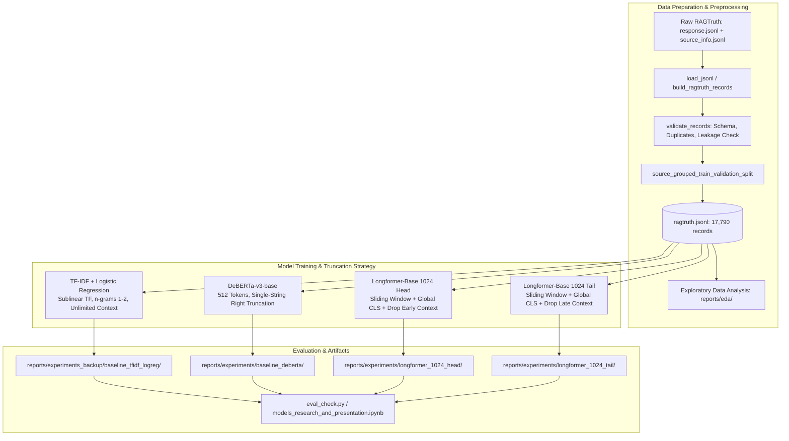
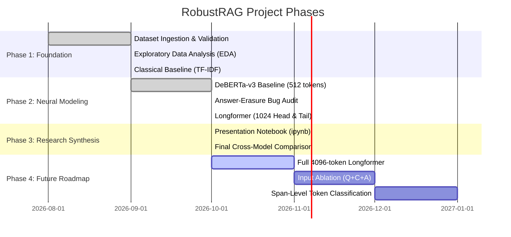

# RobustRAG

[](https://www.python.org/downloads/)
[](https://opensource.org/licenses/MIT)
[](tests/)

A research project for hallucination detection in Retrieval-Augmented Generation (RAG) systems, built on the [RAGTruth](https://arxiv.org/abs/2401.00396) benchmark.

Given a retrieved context $C$ and a generated answer $A$, RobustRAG trains and evaluates binary classifiers to determine whether the answer is **supported** (grounded in the context) or **hallucinated** (containing ungrounded or contradicted claims).

---

## 1. Project Overview

Retrieval-Augmented Generation mitigates language model factual errors by conditioning generation on external evidence passages. However, LLMs regularly generate unsupported extrapolations or direct contradictions even when the supporting passage is present.

### Core Objectives
- **Accurate Grounding Verification:** Detect both factual conflicts and baseless information across diverse generation models and task types.
- **Solving the Sequence Length Bottleneck:** Standard transformer cross-encoders (512 tokens) truncate long retrieved contexts and discard generated answers. RobustRAG implements dynamic **answer-preserving tokenization** and extended sliding-window attention (1024 tokens) via Longformer.
- **Reproducible Empirical Methodology:** Every experiment snapshots its exact configuration, model weights, metrics suite, and per-example predictions for auditing.

---

## 2. End-to-End Pipeline



---

## 3. Evaluated Models & Verified Results

All four models were evaluated on the fixed test split ([test.jsonl](data/processed/test.jsonl), $N = 2,700$ records, 34.93% hallucination rate). Metrics are compiled directly from the archived `metrics.json` experiment artifacts:

| Model Architecture | Context Cap | Truncation / Attention Strategy | Accuracy | Precision | Recall | F1-Score | ROC-AUC | PR-AUC |
| :--- | :---: | :--- | :---: | :---: | :---: | :---: | :---: | :---: |
| **TF-IDF + Logistic Reg** | Unlimited | Sublinear TF, unigrams+bigrams, $C=1.0$ | 76.78% | 69.04% | 60.76% | 64.64% | 0.7977 | 0.7333 |
| **DeBERTa-v3-base** | 512 | Disentangled attention, single-string right truncation | 75.78% | 64.46% | **68.29%** | 66.32% | 0.7912 | 0.6222 |
| **Longformer (Head)** | 1024 | Local window ($w=512$) + Global CLS + Keep late context | **79.78%** | **74.36%** | 64.26% | **68.94%** | **0.8296** | **0.7527** |
| **Longformer (Tail)** | 1024 | Local window ($w=512$) + Global CLS + Keep early context | 77.56% | 67.94% | 67.66% | 67.80% | 0.8187 | 0.7331 |

### Key Empirical Findings:
1. **The Answer-Erasure Truncation Bug in 512-Token Encoders:**
   In standard single-string tokenization (`[CONTEXT] <ctx> [ANSWER] <ans>`), long contexts cause default right-truncation to slice off the answer. Across the test set, **50.2% of answers were 100% eliminated** before reaching DeBERTa (97.3% in Data-to-text), reducing DeBERTa to random guessing (ROC-AUC 0.5206) on that task. On QA where answers remained intact, DeBERTa decisively outperformed TF-IDF (86.11% vs. 80.89% Acc, 0.8261 vs. 0.6998 ROC-AUC). Detailed post-mortem: [audit_report.md](audit_report.md).
2. **Dynamic Answer-Preserving Longformer:**
   Longformer introduced `encode_pair_with_answer_preservation`, allocating budget to the answer first and dedicating remaining tokens to context. Combined with an extended 1024-token budget, it achieved project-leading scores across Accuracy, Precision, F1, ROC-AUC, and PR-AUC.
3. **Head vs. Tail Context Truncation:**
   Keeping the trailing portion of the context closest to the answer (**Head truncation**) outperformed keeping the beginning (**Tail truncation**), reducing false positive alarms by **30.6%** (209 vs. 301 false positives).

---

## 4. Repository Structure

```
RobustRAG/
|-- configs/
|   |-- default.yaml                    # Global baseline & DeBERTa training configuration
|   |-- longformer_1024_head.yaml       # Longformer config with head truncation
|   `-- longformer_1024_tail.yaml       # Longformer config with tail truncation
|-- data/
|   |-- raw/                            # Original RAGTruth files (git-ignored)
|   `-- processed/
|       |-- ragtruth.jsonl              # Canonical dataset (17,790 records)
|       |-- train.jsonl                 # Train split (13,578 records)
|       |-- validation.jsonl            # Source-grouped validation split (1,512 records)
|       `-- test.jsonl                  # Fixed test split (2,700 records)
|-- reports/
|   |-- eda/                            # 19 EDA figures and summary statistics
|   |-- experiments/
|   |   |-- baseline_deberta/           # DeBERTa checkpoint and metrics
|   |   |-- longformer_1024_head/       # Best model: Longformer Head weights and predictions
|   |   `-- longformer_1024_tail/       # Longformer Tail weights and predictions
|   `-- experiments_backup/
|       `-- baseline_tfidf_logreg/      # Classical TF-IDF model bundle and metrics
|-- scripts/
|   |-- prepare_data.py                 # Split and preprocess raw RAGTruth JSONL
|   |-- check_processed_data.py         # Integrity and distribution audit
|   |-- run_eda.py                      # Generate EDA charts
|   |-- train_baseline.py               # Fit and evaluate classical TF-IDF model
|   |-- train_deberta.py                # Train DeBERTa-v3 baseline
|   `-- train_longformer.py             # Train Longformer Head/Tail models
|-- src/hallucination_detector/
|   |-- data/
|   |   |-- schema.py                   # RAGTruthRecord dataclass
|   |   |-- torch_dataset.py            # Answer-preserving tokenization & PyTorch Datasets
|   |   |-- splitting.py                # Source-grouped cross-validation splitting
|   |   `-- validation.py               # Preprocessing validation & audits
|   |-- modeling/
|   |   |-- tfidf_logistic.py           # TF-IDF + Logistic Regression implementation
|   |   |-- deberta_classifier.py       # DeBERTa-v3 sequence classification wrapper
|   |   `-- longformer_classifier.py    # Longformer with global attention classification
|   |-- training/
|   |   |-- deberta_baseline.py         # DeBERTa training loop with BF16 & early stopping
|   |   `-- longformer_train.py         # Longformer training loop with gradient accumulation
|   `-- evaluation/
|       `-- metrics.py                  # Full metric suite (Acc, Prec, Rec, F1, ROC, PR, CM)
|-- tests/                              # 24 unit and integration tests (100% passing)
|-- eval_check.py                       # Lightweight evaluation & checkpoint verification script
|-- audit_report.md                     # Deep-dive audit report on truncation effects
|-- models_research_and_presentation.ipynb # Comprehensive research & presentation notebook
|-- pyproject.toml                      # Project metadata, dependencies, and build config
`-- requirements.txt                    # Pinned environment specification
```

---

## 5. Setup & Installation

The project requires Python $\ge 3.12$ and uses [uv](https://docs.astral.sh/uv/) for high-speed, deterministic package management.

### Windows PowerShell Setup

```powershell
# 1. Clone repository and navigate to workspace
git clone https://github.com/nishantwhat/RobustRAG.git
cd RobustRAG

# 2. Install uv if not already installed
pip install uv

# 3. Create virtual environment and synchronize dependencies
uv venv .venv
.\.venv\Scripts\Activate.ps1
uv sync

# 4. Verify PyTorch CUDA support
python -c "import torch; print(f'PyTorch {torch.__version__} | CUDA Available: {torch.cuda.is_available()}')"
```

---

## 6. Dataset Preparation & Ingestion

RobustRAG uses the human-annotated [RAGTruth Benchmark](https://arxiv.org/abs/2401.00396) ([GitHub: RAGTruth](https://github.com/luomancs/RAGTruth)), licensed under MIT.

### Ingestion Commands
Place raw `response.jsonl` and `source_info.jsonl` into `data/raw/` and run:

```powershell
# Preprocess, validate schema, and generate source-grouped splits
uv run python scripts/prepare_data.py `
  --responses data/raw/response.jsonl `
  --sources data/raw/source_info.jsonl `
  --output-dir data/processed

# Audit integrity of processed records
uv run python scripts/check_processed_data.py
```

### Dataset Composition:
- **Total records:** 17,790 (Train: 13,578, Validation: 1,512, Test: 2,700).
- **Task distribution:** 900 QA, 900 Summarization, 900 Data-to-text in the test split.
- **Source generators:** GPT-4, GPT-3.5-Turbo, Llama-2 (7B, 13B, 70B), Mistral-7B-Instruct.
- **Split integrity:** Source IDs are strictly disjoint between train and test to prevent passage leakage.

---

## 7. Execution Commands

### A. Run Test Suite
```powershell
uv run pytest -q
```
*Current status: 24 passed tests covering loaders, schemas, answer-preservation tokenization, model loading, and metrics.*

### B. Train Models
```powershell
# 1. Train TF-IDF + Logistic Regression baseline
uv run python scripts/train_baseline.py

# 2. Train DeBERTa-v3-base (512 tokens)
uv run python scripts/train_deberta.py

# 3. Train Longformer-Base (1024 tokens, Head truncation - Best Model)
uv run python scripts/train_longformer.py `
  --config configs/longformer_1024_head.yaml `
  --output reports/experiments/longformer_1024_head

# 4. Train Longformer-Base (1024 tokens, Tail truncation)
uv run python scripts/train_longformer.py `
  --config configs/longformer_1024_tail.yaml `
  --output reports/experiments/longformer_1024_tail
```

### C. Evaluate Checkpoints Directly
To run fast evaluation of the best Longformer checkpoint on the test set:
```powershell
uv run python eval_check.py
```

### D. Interactive Presentation & Research Notebook
Launch the presentation notebook to explore all comparative charts, confusion matrices, and the 5-case qualitative study:
```powershell
uv run jupyter notebook models_research_and_presentation.ipynb
```

---

## 8. Checkpoints & Inference

### Model Weights Storage
Trained transformer checkpoints are saved in Hugging Face compatible format:
- **Best Model:** `reports/experiments/longformer_1024_head/best_model/` (`model.safetensors`, `config.json`, tokenizer files).
- **DeBERTa Baseline:** `reports/experiments/baseline_deberta/best_model/`.
- **Classical Baseline:** `reports/experiments_backup/baseline_tfidf_logreg/model.pkl`.

> **Note on Model Checkpoint Distribution:** Large weight files (`*.safetensors`, `best_optimizer.pt`) exceed Git file limits and are excluded by `.gitignore`. For external distribution, model weights should be packaged and attached to GitHub Releases or hosted on Hugging Face Model Hub (pending external release).

### Programmatic Inference (Python)
You can run zero-shot hallucination inference directly using saved checkpoints without retraining:

```python
from src.hallucination_detector.data.schema import RAGTruthRecord
from src.hallucination_detector.modeling.longformer_classifier import LongformerClassifier

# Load trained Longformer-Head checkpoint
model = LongformerClassifier.from_pretrained(
    "reports/experiments/longformer_1024_head/best_model",
    max_length=1024,
    truncation_strategy="head",
    global_attention_mode="cls"
)

# Define query sample
record = RAGTruthRecord(
    id="demo_1",
    source_id="src_1",
    context="The Federal Reserve raised interest rates by 25 basis points on Wednesday.",
    answer="The Federal Reserve decided to cut interest rates by 50 basis points.",
    question="What did the Federal Reserve do?",
    hallucinated=True
)

# Predict probabilities: [P(supported), P(hallucinated)]
probs = model.predict_proba([record], device="cuda", bf16=True)
print(f"Hallucination Probability: {probs[0, 1]:.4f}")
# Output: > 0.85 (Correctly flags hallucination)
```

---

## 9. Project Phases & Roadmap



| Phase | Milestone | Status | Description |
| :--- | :--- | :---: | :--- |
| **Phase 1** | Ingestion & Baseline | **Completed** | Clean pipeline on RAGTruth, source-grouped splitting, TF-IDF benchmark (76.78% Acc). |
| **Phase 2** | Pretrained Transformers | **Completed** | Trained DeBERTa-v3-base; audited the Answer-Erasure bug; built answer-preserved Longformer (79.78% Acc, 0.8296 ROC-AUC). |
| **Phase 3** | Presentation & Disagreements | **Completed** | Created `models_research_and_presentation.ipynb` with 5-case study, ROC/PR curves, and Brier calibration analysis. |
| **Phase 4** | Advanced Scaling | **Planned** | Full 4,096-token sliding-window Longformer; Question-Context-Answer ($Q+C+A$) ablation; span-level multi-task classification. |

---

## 10. References & Citations

1. **RAGTruth Benchmark Paper:**  
   Yuan, Y., et al. (2024). *RAGTruth: A Hallucination Benchmark for Retrieval-Augmented Generation*. [arXiv:2401.00396](https://arxiv.org/abs/2401.00396).
2. **Longformer Architecture:**  
   Beltagy, I., Peters, M. E., & Cohan, A. (2020). *Longformer: The Long-Document Transformer*. [arXiv:2004.05150](https://arxiv.org/abs/2004.05150).
3. **DeBERTa-v3:**  
   He, P., Gao, J., & Chen, W. (2021). *DeBERTaV3: Improving DeBERTa using ELECTRA-Style Pre-Training with Gradient-Disentangled Embedding Sharing*. [arXiv:2111.09543](https://arxiv.org/abs/2111.09543).
4. **Hugging Face Model Cards:**
   - [`allenai/longformer-base-4096`](https://huggingface.co/allenai/longformer-base-4096)
   - [`microsoft/deberta-v3-base`](https://huggingface.co/microsoft/deberta-v3-base)

---

## 11. Contributors & License

- **Author:** Nishant Bothra ([GitHub: nishantwhat](https://github.com/nishantwhat))
- **License:** Released under the [MIT License](LICENSE).
