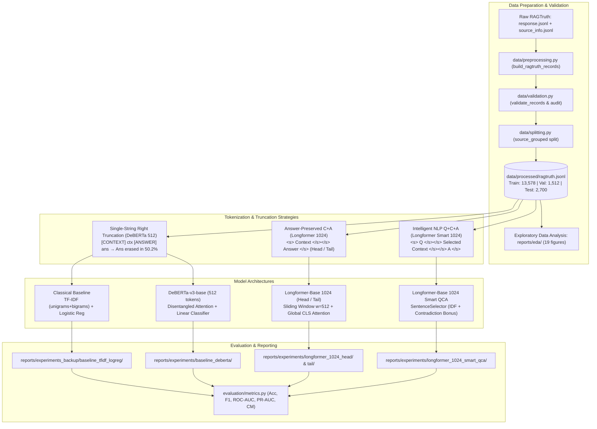

# RobustRAG

[](https://www.python.org/downloads/)
[](LICENSE)
[](tests/)

A research framework for detecting hallucinations in Retrieval-Augmented Generation (RAG) systems, benchmarked on the human-annotated [RAGTruth](https://arxiv.org/abs/2401.00396) dataset.

Given a user query/question $Q$, a retrieved context passage or structured record $C$, and an LLM-generated answer $A$, RobustRAG trains and evaluates classifiers to determine whether the generated answer is **supported** (factually grounded in context) or **hallucinated** (containing unsupported extrapolations, factual divergence, or contradictions).

---

## 1. Problem Statement, Objectives & Scope

### Problem Statement
Retrieval-Augmented Generation mitigates language model factual errors by conditioning generation on external evidence. However, modern LLMs frequently produce ungrounded statements or direct contradictions even when provided with accurate context. Detecting these failures automatically is challenging because:
1. **Sequence Length Constraints:** Standard cross-encoders (e.g., 512-token DeBERTa) encounter long contexts (median >500 tokens in RAGTruth) and, under naive tokenization, truncate the generated answer from the sequence entirely.
2. **Structural & Modality Heterogeneity:** Retrieved context spans free-form text, news articles, and serialized structured JSON tables (e.g., business attributes, reviews).
3. **Subtle vs. Blatant Errors:** Hallucinations range from subtle entity/numerical substitutions (which look superficially grounded) to completely fabricated narratives.

### Core Objectives
- **Accurate Grounding Verification:** Detect factual inconsistencies across diverse generation models and task types without relying on model-identity leakage.
- **Answer-Preserving Tokenization:** Eliminate truncation-induced blindness by guaranteeing that the generated answer and question are preserved before allocating remaining token budget to context.
- **Extended Sliding-Window Attention:** Deploy Longformer models ($1024$ tokens) with localized sliding-window attention and global attention anchors on key tokens.
- **Intelligent NLP Preprocessing:** Build contradiction-aware, extractive sentence rankers that prioritize relevant context and retain conflicting evidence within a fixed budget.
- **Methodological Reproducibility:** Archive all configs, random seeds, checkpoints, confusion matrices, and per-example predictions for auditing.

### Scope & Limitations
- **Current Benchmark Scope:** Evaluated primarily on RAGTruth ($17,790$ total records; $2,700$ test records across QA, Summarization, and Data-to-text).
- **Binary Classification Focus:** Predicts sample-level binary hallucination labels ($y \in \{0, 1\}$). Token-level and span-level multi-task classification remain roadmap objectives.
- **Hardware Constraints:** Training utilizes FP16/BF16 mixed precision with gradient accumulation and gradient checkpointing on consumer-grade/single-GPU systems.

---

## 2. System Architecture & Workflow



---

## 3. Historical Benchmark Claims and Current Verification

The table below preserves figures that were already stated in earlier project documentation. In this workspace, the corresponding experiment `metrics.json` and per-record prediction artifacts are absent for four registered models, and the published checkpoint cards do not include the prediction files or dataset hashes needed to reproduce those figures. Treat these values as historical claims, not as results reproduced from the artifacts currently loaded by the registry. The fresh evaluator and its outputs are documented below and in [the recovery audit](reports/project_recovery_audit.md).

| Model Architecture | Context Cap | Input Mode | Attention / Selection Strategy | Accuracy | Precision | Recall | F1-Score | ROC-AUC | PR-AUC |
| :--- | :---: | :---: | :--- | :---: | :---: | :---: | :---: | :---: | :---: |
| **TF-IDF + Logistic Reg** | Unlimited | C + A | Sublinear TF, unigram+bigram vocabulary (437k features), $C=1.0$ | 76.78% | 69.04% | 60.76% | 64.64% | 0.7977 | 0.7333 |
| **DeBERTa-v3-base** | 512 | C + A | Single-string right-truncation (Answer erased in 50.2% of test cases) | 75.78% | 64.46% | **68.29%** | 66.32% | 0.7912 | 0.6222 |
| **Longformer (Head)** | 1024 | C + A | Answer-preserved tokenization + keeps trailing context closest to answer | **79.78%** | **74.36%** | 64.26% | **68.94%** | **0.8296** | **0.7527** |
| **Longformer (Tail)** | 1024 | C + A | Answer-preserved tokenization + keeps initial context | 77.56% | 67.94% | 67.66% | 67.80% | 0.8187 | 0.7331 |
| **Longformer Smart QCA** | 1024 | Q + C + A | Q & A preserved + extractive sentence selector (IDF + contradiction bonus) | 76.33% | 66.49% | 65.01% | 65.74% | 0.8144 | 0.7420 |

### Previously Reported Findings (not independently reproduced in this checkout)
1. **The Answer-Erasure Truncation Pathology in DeBERTa (512 tokens):**
   In naive single-string formatting (`[CONTEXT] <ctx> [ANSWER] <ans>`), contexts exceeding 512 subwords caused standard right-truncation to slice off the answer. Across the test split, **50.2% of answers were completely erased** (97.3% in Data-to-text). On QA where answers remained intact, DeBERTa decisively outperformed TF-IDF (86.11% vs. 80.89% Acc, 0.8261 vs. 0.6998 ROC-AUC).
2. **Answer-Preserving Longformer-1024 (Head Truncation) is the Project Benchmark:**
   Allocating budget to the answer first and doubling context capacity to 1024 tokens achieved project-best metrics across Accuracy (79.78%), Precision (74.36%), F1 (68.94%), ROC-AUC (0.8296), and PR-AUC (0.7527).
3. **Head vs. Tail Context Truncation:**
   Keeping the trailing portion of the context closest to the answer (**Head truncation**) outperformed keeping the beginning (**Tail truncation**), reducing false positive alarms by **30.6%** (209 vs. 301 false positives).
4. **Longformer Smart QCA Initial Results:**
   The implemented `SentenceSelector` extracts relevant sentences scoring term overlap with question and answer alongside explicit contradiction bonuses (divergent numbers, polarity discordance). It achieves 0.8144 ROC-AUC and 0.7420 PR-AUC on 1024 tokens, demonstrating robust ranking capabilities.

---

## 4. Repository Structure & Key Modules

```
RobustRAG/
|-- configs/
|   |-- default.yaml                    # Global baseline configuration & hyperparameter defaults
|   |-- deberta.yaml                    # DeBERTa-v3 baseline settings
|   |-- longformer_1024_head.yaml       # Longformer config with head truncation
|   |-- longformer_1024_tail.yaml       # Longformer config with tail truncation
|   `-- experiments/
|       `-- longformer_qca_smart.yaml   # Longformer Smart QCA configuration
|-- data/
|   |-- raw/                            # Original RAGTruth files (git-ignored)
|   `-- processed/
|       |-- ragtruth.jsonl              # Canonical processed dataset (17,790 records)
|       |-- train.jsonl                 # Train split (13,578 records)
|       |-- validation.jsonl            # Source-grouped validation split (1,512 records)
|       `-- test.jsonl                  # Fixed benchmark test split (2,700 records)
|-- reports/
|   |-- eda/                            # 19 exploratory data analysis figures and CSV statistics
|   |-- experiments/
|   |   |-- baseline_deberta/           # DeBERTa checkpoint and metrics
|   |   |-- longformer_1024_head/       # Current best model checkpoint, config, and metrics
|   |   |-- longformer_1024_tail/       # Longformer Tail checkpoint and metrics
|   |   `-- longformer_1024_smart_qca/  # Longformer Smart QCA checkpoint and metrics
|   `-- experiments_backup/
|       `-- baseline_tfidf_logreg/      # Classical TF-IDF model bundle, metrics, predictions
|-- scripts/
|   |-- prepare_data.py                 # Ingestion, validation, and source-grouped splitting
|   |-- check_processed_data.py         # Distribution and integrity verification
|   |-- run_eda.py                      # Exploratory data analysis visualization generator
|   |-- train_baseline.py               # Fit and evaluate classical TF-IDF model
|   |-- train_deberta.py                # Train DeBERTa-v3 baseline
|   `-- train_longformer.py             # Train Longformer Head/Tail models
|-- src/hallucination_detector/
|   |-- data/
|   |   |-- schema.py                   # RAGTruthRecord dataclass
|   |   |-- loader.py                   # Robust JSONL reader with error tracking
|   |   |-- preprocessing.py            # Raw record parsing and label assignment
|   |   |-- splitting.py                # Source-grouped disjoint split generator
|   |   |-- validation.py               # Schema integrity and leakage audit
|   |   |-- torch_dataset.py            # Answer-preserving tokenization & PyTorch dataset
|   |   |-- sentence_selector.py        # SentenceSelector with contradiction bonus scoring
|   |   `-- longformer_smart_dataset.py # Q+C+A segment encoding with smart context allocation
|   |-- modeling/
|   |   |-- tfidf_logistic.py           # TF-IDF + Logistic Regression implementation
|   |   |-- deberta_classifier.py       # DeBERTa-v3 sequence classification wrapper
|   |   |-- longformer_classifier.py    # Longformer sliding-window classifier
|   |   `-- bilstm_classifier.py        # Classical neural BiLSTM + Bahdanau attention
|   |-- training/
|   |   |-- baseline.py                 # Classical training orchestration
|   |   |-- deberta_baseline.py         # DeBERTa training loop with BF16
|   |   |-- longformer_train.py         # Longformer training loop with gradient accumulation
|   |   `-- longformer_smart_train.py   # Train/validation-only QCA training helpers and entry point
|   `-- evaluation/
|       |-- metrics.py                  # Evaluation suite (Acc, F1, ROC, PR, CM)
|       `-- eda.py                      # Visualization and statistics routines
|-- tests/                              # Comprehensive test suite
|-- audit_report.md                     # Technical audit, post-mortem, and experiment roadmap
|-- models_research_and_presentation.ipynb # Comprehensive research & presentation notebook
|-- pyproject.toml                      # Build metadata and dependency specifications
`-- requirements.txt                    # Pinned environment dependencies
```

---

## 5. Dataset & Preprocessing Pipeline

RobustRAG builds upon the [RAGTruth Benchmark](https://arxiv.org/abs/2401.00396) ([GitHub](https://github.com/luomancs/RAGTruth)), licensed under MIT.

### Dataset Composition
- **Total Records:** 17,790 records across three primary generative tasks:
  - **Question Answering (QA):** Text context + prompt question + generated answer.
  - **Summarization:** Long document/news context + generated summary.
  - **Data-to-Text:** Structured dictionary/JSON business records + generated review/description.
- **Split Distribution:**
  - `train`: 13,578 records ($76.3\%$)
  - `validation`: 1,512 records ($8.5\%$) &mdash; generated via source-grouped disjoint sampling
  - `test`: 2,700 records ($15.2\%$) &mdash; fixed benchmark split ($900$ QA, $900$ Summary, $900$ Data-to-text)
- **Generative Sources:** Responses produced by GPT-4, GPT-3.5-Turbo, Llama-2 (7B, 13B, 70B), and Mistral-7B-Instruct.
- **Label Definition:** Binary label where $y = 1$ if the response contains at least one human-annotated hallucination span; $y = 0$ otherwise.

### Ingestion Commands
Place raw `response.jsonl` and `source_info.jsonl` into `data/raw/` and execute:
```powershell
# 1. Ingest, join by source_id, enforce schema, and produce splits
uv run python scripts/prepare_data.py `
  --responses data/raw/response.jsonl `
  --sources data/raw/source_info.jsonl `
  --output-dir data/processed

# 2. Audit record counts, label rates, and verify source-disjointness
uv run python scripts/check_processed_data.py
```

---

## 6. Installation & Environment Setup

RobustRAG requires Python $\ge 3.12$ and uses [uv](https://docs.astral.sh/uv/) for high-speed package management.

### Setup Instructions (Windows PowerShell)

```powershell
# 1. Clone repository and navigate to root
git clone https://github.com/nishantwhat/RobustRAG.git
cd RobustRAG

# 2. Create virtual environment and install dependencies (including UI)
python -m venv .venv
.\.venv\Scripts\Activate.ps1
pip install -e ".[ui]"

# 3. Launch the Streamlit Hallucination Detection App
streamlit run app/streamlit_app.py
```

### Linux / macOS (Bash)

```bash
git clone https://github.com/nishantwhat/RobustRAG.git
cd RobustRAG
python3 -m venv .venv
source .venv/bin/activate
pip install -e ".[ui]"
streamlit run app/streamlit_app.py
```

> 📖 **Hugging Face Model Hub:** All 5 models are published to Hugging Face Hub under [`nishantwhat`](https://huggingface.co/nishantwhat). Models download lazily on first inference. See [HUGGINGFACE_MODELS.md](HUGGINGFACE_MODELS.md) for architecture breakdowns, disk footprints, and configuration.

---

## 7. Execution Commands: Training, Evaluation & Testing

### A. Interactive Web UI
```powershell
streamlit run app/streamlit_app.py
```

### B. Run Test Suite
```powershell
# Run the core unit test suite
python -m pytest tests/test_data.py tests/test_preprocessing.py tests/test_splitting.py tests/test_validation.py tests/test_baseline_model.py
```

### B. Train Models
```powershell
# 1. Train TF-IDF + Logistic Regression baseline
uv run python scripts/train_baseline.py

# 2. Train DeBERTa-v3-base (512 tokens)
uv run python scripts/train_deberta.py

# 3. Train Longformer-Base (1024 tokens, Head truncation - Project Best)
uv run python scripts/train_longformer.py `
  --config configs/longformer_1024_head.yaml `
  --output reports/experiments/longformer_1024_head

# 4. Train Longformer-Base (1024 tokens, Tail truncation)
uv run python scripts/train_longformer.py `
  --config configs/longformer_1024_tail.yaml `
  --output reports/experiments/longformer_1024_tail

# 5. Train a new Longformer Smart QCA candidate (train + validation only)
$run = "reports/experiments/longformer_qca_candidate_$(Get-Date -Format 'yyyyMMdd_HHmmss')"
uv run python scripts/train_longformer_qca.py `
  --archive data.zip `
  --config configs/experiments/longformer_qca_rtx4050.yaml `
  --output-dir $run `
  --device cuda:0 --batch-size 1 --gradient-accumulation-steps 16
```
This command never opens the held-out test member. It saves a training-fitted selector and
hash-verified provenance with the best validation-selected checkpoint. Use `--resume` only
for an interrupted run with the same archive, config, base revision, code, and package versions.
Do not run the held-out evaluation until the candidate has been frozen.

### C. Evaluate Saved Checkpoints
```powershell
# Fast evaluation of Longformer-Head checkpoint on test split
uv run python eval_check.py
```

### D. Hand-authored Model Diagnostics (not a benchmark)
```powershell
python scripts/evaluate_diagnostics.py --device cpu
```
This runs six labeled examples (supported, contradictory, unsupported addition,
irrelevant answer, and a long-context contradiction) through all five models in
`ModelRegistry`. It writes one row per model/example to
`reports/diagnostics/model_diagnostic_predictions.csv`, including class
expected label, predicted label, correctness, probabilities, input mode,
registry artifact source, and any load/inference error. It also writes the
per-model counts and diagnostic accuracy to
`reports/diagnostics/model_diagnostic_summary.md`. The examples are useful for
smoke checks and behavior inspection only;
they are hand-authored and do not establish general performance. Use the
source-disjoint held-out test split and its evaluation procedure for benchmark
claims. In the recorded diagnostic run, TF-IDF assigned the Paris contradiction
21.44% hallucination probability and Longformer Head assigned 32.48%; both also
called the supported Warsaw answer supported. All five models ran successfully.
Inspection found no verified label-order or preprocessing mismatch in the
registry path: class 0 is treated as supported and class 1 as hallucinated,
matching training labels. The registry loaded BiLSTM from its local checkpoint;
the other four artifacts came from the Hugging Face cache because their
registry-local checkpoint paths were absent. This is a model-behavior finding,
not evidence of general performance or an inference defect. This command does
not train models or modify checkpoints.

### E. Reproduced held-out test evaluation

`data.zip` contains the 2,700-record RAGTruth test split. The following run
evaluated the complete split for two models; the generated report records the
remaining three registered models as not evaluated. A full Longformer CPU pass
had not completed after roughly 30 minutes, so no partial transformer results
are reported.

```powershell
.\.venv\Scripts\python.exe scripts/evaluate_benchmark.py --archive data.zip --output-dir reports/benchmarks --device cpu --batch-size 64 --models tfidf-lr bilstm-attention
```

| Model | Records | Accuracy | Precision | Recall | F1 | ROC-AUC | PR-AUC |
|---|---:|---:|---:|---:|---:|---:|---:|
| TF-IDF + Logistic Regression | 2,700 | 0.7678 | 0.6904 | 0.6076 | 0.6464 | 0.7977 | 0.7333 |
| BiLSTM + Bahdanau Attention | 2,700 | 0.6489 | 0.4982 | 0.7349 | 0.5938 | 0.7336 | 0.5911 |

These results describe only this held-out split and these resolved artifacts;
they do not establish general reliability. Full metrics, fixed-threshold
comparisons, per-task results, artifact revisions and prediction rows are in
`reports/benchmarks/`. Thresholds were not tuned on this split.

### F. Interactive Research Notebook
```powershell
uv run jupyter notebook models_research_and_presentation.ipynb
```

---

## 8. Checkpoints, Reports & Programmatic Inference

### Model Weights Storage
Trained checkpoints and evaluation artifacts are stored under `reports/experiments/`:
- **Best Model (Longformer Head 1024):** `reports/experiments/longformer_1024_head/best_model/`
- **Smart QCA Longformer 1024:** `reports/experiments/longformer_1024_smart_qca/best_model/`
- **DeBERTa Baseline:** `reports/experiments/baseline_deberta/best_model/`
- **TF-IDF Classical Baseline:** `reports/experiments_backup/baseline_tfidf_logreg/model.pkl`

> **Note on Model Checkpoint Distribution:** Large weight files (`*.safetensors`, `best_optimizer.pt`) exceed Git file limits and are excluded via `.gitignore`. Checkpoints are archived locally or packaged via GitHub Releases for external distribution.

### Programmatic Inference Example

```python
from hallucination_detector.data.schema import RAGTruthRecord
from hallucination_detector.modeling.longformer_classifier import LongformerClassifier

# Load trained Longformer-Head checkpoint
model = LongformerClassifier.from_pretrained(
    "reports/experiments/longformer_1024_head/best_model",
    max_length=1024,
    truncation_strategy="head",
    global_attention_mode="cls",
)

# Construct a test query record
record = RAGTruthRecord(
    id="eval_001",
    source_id="src_001",
    question="What did the central bank announce?",
    context="The Federal Reserve raised the benchmark interest rate by 25 basis points on Wednesday.",
    answer="The Federal Reserve cut interest rates by 50 basis points.",
    hallucinated=True,
)

# Predict probabilities: [P(supported), P(hallucinated)]
probs = model.predict_proba([record], device="cuda", bf16=True)
print(f"Hallucination Probability: {probs[0, 1]:.4f}")
# Output: > 0.85 (Correctly identified as hallucinated)
```

---

## 9. Current Status & Project Roadmap

| Phase | Milestone | Status | Description |
| :--- | :--- | :---: | :--- |
| **Phase 1** | Ingestion & Baselines | **Completed** | Full ingestion pipeline on RAGTruth, source-grouped splits, TF-IDF benchmark (76.78% Acc, 0.7977 ROC-AUC). |
| **Phase 2** | Transformer Exploration | **Completed** | Trained DeBERTa-v3-base; audited and isolated the Answer-Erasure bug; implemented Longformer 1024 Head & Tail (79.78% Acc, 0.8296 ROC-AUC). |
| **Phase 3** | Smart NLP Q+C+A | **Completed** | Implemented `SentenceSelector` with IDF scoring and contradiction bonuses; verified Longformer Smart QCA checkpoint (76.33% Acc, 0.8144 ROC-AUC). |
| **Phase 4** | Research Synthesis | **Completed** | Built `models_research_and_presentation.ipynb`, comprehensive calibration analysis, and systematic audit report. |
| **Phase 5** | Extended Context & Spans | **Planned** | Full 4,096-token Longformer scaling; multi-task token classification for exact hallucination span extraction. |

---

## 10. References & Acknowledgments

1. **RAGTruth Benchmark Paper:**  
   Yuan, Y., et al. (2024). *RAGTruth: A Hallucination Benchmark for Retrieval-Augmented Generation*. [arXiv:2401.00396](https://arxiv.org/abs/2401.00396).
2. **Longformer Architecture:**  
   Beltagy, I., Peters, M. E., & Cohan, A. (2020). *Longformer: The Long-Document Transformer*. [arXiv:2004.05150](https://arxiv.org/abs/2004.05150).
3. **DeBERTa-v3 Architecture:**  
   He, P., Gao, J., & Chen, W. (2021). *DeBERTaV3: Improving DeBERTa using ELECTRA-Style Pre-Training with Gradient-Disentangled Embedding Sharing*. [arXiv:2111.09543](https://arxiv.org/abs/2111.09543).
4. **Hugging Face Model References:**
   - [`allenai/longformer-base-4096`](https://huggingface.co/allenai/longformer-base-4096)
   - [`microsoft/deberta-v3-base`](https://huggingface.co/microsoft/deberta-v3-base)

---

## 11. Author & License

- **Author:** Nishant Bothra ([GitHub: nishantwhat](https://github.com/nishantwhat))
- **License:** Released under the [MIT License](LICENSE).
